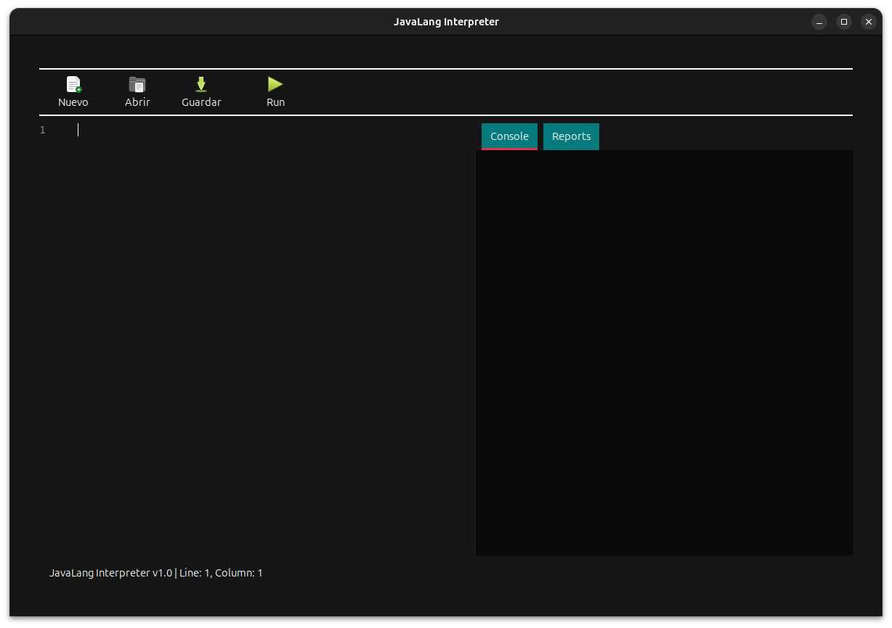
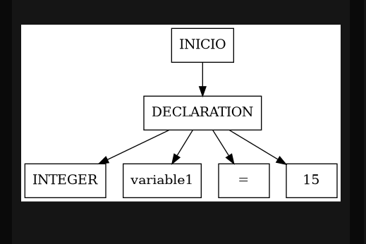
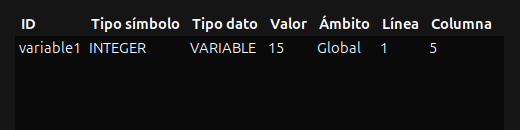
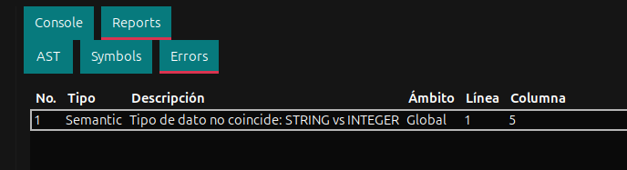

# Manual de Usuario - Compilador JavaLang


- Diego Alejadandro Vásquez ALonzo - 202300638

## Tabla de Contenidos
1. [Introducción](#introducción)
2. [Requisitos del Sistema](#requisitos-del-sistema)
3. [Instalación](#instalación)
4. [Interfaz de Usuario](#interfaz-de-usuario)
5. [Creación y Edición de Código](#creación-y-edición-de-código)
6. [Ejecución del Compilador](#ejecución-del-compilador)
7. [Interpretación de Reportes](#interpretación-de-reportes)
8. [Ejemplos de Uso](#ejemplos-de-uso)
9. [Resolución de Problemas](#resolución-de-problemas)
10. [Extensiones de Archivo](#extensiones-de-archivo)

---

## Introducción

JavaLang es un compilador educativo desarrollado en C que implementa un subconjunto del lenguaje Java. La herramienta incluye:

- **Editor de código integrado** con resaltado de sintaxis
- **Compilador léxico y sintáctico** con análisis semántico
- **Generación de reportes** (AST, tabla de símbolos, errores)
- **Interfaz gráfica** desarrollada con GTK+ 3.0
- **Soporte para archivos .usl** (Universidad de San Carlos Language)

---

## Requisitos del Sistema

### Requisitos Mínimos
- **Sistema Operativo**: Linux (Ubuntu 20.04+ recomendado)
- **RAM**: 512 MB mínimo, 1 GB recomendado
- **Espacio en disco**: 100 MB para la instalación
- **Compilador**: GCC 9.0 o superior
- **Make**: GNU Make 4.2+

### Dependencias de Software
```bash
# Librerías de desarrollo requeridas
sudo apt-get install build-essential
sudo apt-get install libgtk-3-dev
sudo apt-get install flex bison
sudo apt-get install pkg-config
sudo apt-get install libglib2.0-dev
```

---

## Instalación

### Paso 2: Verificar Dependencias
```bash
# Verificar que todas las dependencias están instaladas
make check-deps
```

### Paso 3: Compilar el Proyecto
```bash
# Compilación estándar
make

# Compilación con información de depuración
make debug

# Limpieza de archivos objeto
make clean
```

### Paso 4: Verificar la Instalación
```bash
# Ejecutar el programa
./build/main

# Verificar versión
./build/main --version
```

### Estructura de Archivos Post-Instalación
```
OLC2_2S_2025_202300638/
├── build/
│   ├── main                    # Ejecutable principal
│   ├── lexer.yy.c             # Analizador léxico generado
│   ├── parser.tab.c           # Analizador sintáctico generado
│   └── parser.tab.h           # Headers del parser
├── src/
│   ├── main.c                 # Punto de entrada
│   ├── parser/                # Compilador
│   ├── UI/                    # Interfaz gráfica
│   ├── structures/            # Estructuras de datos
│   └── reports/               # Generación de reportes
├── test/
│   └── *.usl                  # Archivos de prueba
└── reports/                   # Reportes generados
```

---

## Interfaz de Usuario

### Componentes Principales

#### 1. Barra de Menú
```
Archivo  Editar  Compilar  Reportes  Ayuda
```

#### 2. Barra de Herramientas
- **Nuevo** 📄 - Crear archivo nuevo
- **Abrir** 📁 - Abrir archivo existente
- **Guardar** 💾 - Guardar archivo actual
- **Ejecutar** ▶️ - Compilar y ejecutar
- **Parar** ⏹️ - Detener ejecución

#### 3. Panel Principal
- **Editor de código** (panel izquierdo, 70%)
- **Panel de reportes** (panel derecho, 30%)

#### 4. Panel de Estado
- **Línea actual**: Muestra posición del cursor
- **Estado de compilación**: Éxito/Error
- **Tiempo de ejecución**: Duración del análisis

### Navegación por la Interfaz

---

## Creación y Edición de Código

### Crear un Nuevo Archivo

#### Método 1: Menú
1. Ir a **Archivo** → **Nuevo**
2. El editor se abrirá con un archivo en blanco
3. Escribir el código JavaLang

#### Método 2: Atajo de Teclado
- **Ctrl+N**: Nuevo archivo
- **Ctrl+O**: Abrir archivo
- **Ctrl+S**: Guardar archivo

### Abrir Archivo Existente

#### Formatos Soportados
- **`.usl`**: Universidad de San Carlos Language (recomendado)
- **`.java`**: Archivos Java estándar
- **`.txt`**: Archivos de texto plano

#### Pasos para Abrir
1. **Archivo** → **Abrir** o **Ctrl+O**
2. Navegar hasta el directorio
3. Seleccionar archivo `.usl`
4. Hacer clic en **Abrir**

### Editor de Código - Características

#### Resaltado de Sintaxis
```java
// Ejemplo de código con resaltado
public class EjemploBasico {
    // Comentario de línea
    private int numero = 42;
    
    /* Comentario de bloque */
    public void metodoEjemplo() {
        String mensaje = "Hola Mundo";
        System.out.println(mensaje);
    }
}
```

#### Colores del Resaltado
- **Palabras clave**: `azul` (public, class, int, void, etc.)
- **Strings**: `verde` ("texto entre comillas")
- **Números**: `naranja` (42, 3.14, etc.)
- **Comentarios**: `gris` (// y /* */)
- **Operadores**: `rojo` (+, -, *, /, =, etc.)

#### Funciones del Editor
1. **Numeración de líneas**: Automática
2. **Indentación automática**: Tab = 4 espacios
3. **Búsqueda de texto**: Ctrl+F
4. **Reemplazar**: Ctrl+H
5. **Deshacer/Rehacer**: Ctrl+Z / Ctrl+Y

---

## Ejecución del Compilador

### Compilación Paso a Paso

#### Paso 1: Preparar el Código
Asegúrate de que tu archivo `.usl` tenga la estructura básica.


#### Paso 2: Ejecutar Compilación
1. **Botón Ejecutar** ▶️ en la barra de herramientas
2. **Menú**: Compilar → Ejecutar
3. **Atajo**: F5 o Ctrl+R

#### Paso 3: Observar el Proceso
```
Iniciando compilación...
├─ Análisis Léxico      ✓ (12ms)
├─ Análisis Sintáctico  ✓ (18ms)
├─ Análisis Semántico   ✓ (15ms)
├─ Generación de AST    ✓ (8ms)
└─ Ejecución           ✓ (3ms)

Total: 56ms
Resultado: ÉXITO
```

### Estados de Compilación

#### ✅ Compilación Exitosa
```
Estado: ÉXITO
Tiempo: 45ms
Salida: El número es: 10
```

#### ❌ Error de Compilación
```
Estado: ERROR
Línea 5: Error sintáctico - ';' esperado
Tiempo: 23ms
```

#### ⚠️ Advertencias
```
Estado: ÉXITO CON ADVERTENCIAS
Línea 3: Variable 'temp' declarada pero no utilizada
Tiempo: 38ms
```

---

## Interpretación de Reportes

### 1. Reporte AST (Árbol de Sintaxis Abstracta)

#### Propósito
El AST muestra la estructura jerárquica del código analizado.

#### Formato Visual
```
AST - Árbol de Sintaxis Abstracta
├─ PROGRAM
│   └─ CLASS_DECLARATION: MiClase
│       └─ METHOD_DECLARATION: main
│           └─ BLOCK
│               ├─ VARIABLE_DECLARATION: numero (int)
│               │   └─ LITERAL: 10
│               └─ METHOD_CALL: println
│                   └─ BINARY_OPERATION: +
│                       ├─ LITERAL: "El número es: "
│                       └─ IDENTIFIER: numero
```

#### Interpretación del AST
- **Nodos padre**: Representan constructos del lenguaje
- **Nodos hijos**: Componentes de cada constructo
- **Hojas**: Valores literales o identificadores




#### Archivos Generados
- `reports/ast.dot`: Formato DOT para Graphviz
- `reports/ast.png`: Imagen del árbol
- `reports/ast.txt`: Representación textual

### 2. Tabla de Símbolos

#### Estructura de la Tabla


#### Columnas Explicadas
- **ID**: Identificador único del símbolo
- **Nombre**: Nombre del identificador en el código
- **Tipo**: Tipo de dato o constructo
- **Ámbito**: Dónde está definido el símbolo
- **Línea**: Línea de declaración en el código

#### Estados de Símbolos
- **Declarado**: ✅ - Símbolo definido correctamente
- **No definido**: ❌ - Símbolo usado pero no declarado
- **No usado**: ⚠️ - Símbolo declarado pero nunca usado

### 3. Reporte de Errores

#### Tipos de Errores

##### Errores Léxicos
```
ERROR LÉXICO - Línea 5, Columna 12
Carácter no válido: '@'
Contexto: int @numero = 10;
                ^
```

##### Errores Sintácticos
```
ERROR SINTÁCTICO - Línea 7, Columna 15
Token inesperado: 'class'
Esperado: ';' o '}'
Contexto: public class MiClase {
                      ^^^^^
```

##### Errores Semánticos
```
ERROR SEMÁNTICO - Línea 10, Columna 9
Variable 'contador' no declarada
Contexto: contador = contador + 1;
          ^^^^^^^^
```

#### Formato del Reporte de Errores
```
REPORTE DE ERRORES
═════════════════

❌ ERROR LÉXICO
Línea: 3, Columna: 15
Descripción: Carácter inesperado '$'
Sugerencia: Verificar caracteres válidos

❌ ERROR SINTÁCTICO  
Línea: 7, Columna: 20
Descripción: Se esperaba ';' después de la declaración
Sugerencia: Agregar punto y coma al final

⚠️  ADVERTENCIA SEMÁNTICA
Línea: 12, Columna: 8
Descripción: Variable 'temp' declarada pero no utilizada
Sugerencia: Remover variable o utilizarla en el código

RESUMEN:
- Errores Léxicos: 1
- Errores Sintácticos: 1  
- Errores Semánticos: 0
- Advertencias: 1
- Total: 3 problemas encontrados
```

---

## Ejemplos de Uso

### Ejemplo 1: Programa Básico

#### Código Fuente (hello.usl)
```java
public class HelloWorld {
    public static void main(String[] args) {
        System.out.println("¡Hola, mundo!");
    }
}
```

#### Pasos de Ejecución
1. **Crear archivo**: Archivo → Nuevo
2. **Escribir código**: Copiar el código anterior
3. **Guardar**: Ctrl+S → `hello.usl`
4. **Compilar**: F5 o botón ▶️
5. **Ver resultado**:
   ```
   Salida: ¡Hola, mundo!
   Estado: ÉXITO
   Tiempo: 32ms
   ```

#### Reporte de Error
```
❌ ERROR SINTÁCTICO
Línea: 3, Columna: 18
Descripción: Se esperaba ';' después de la declaración de variable
Contexto: int x = 10
                  ^
Sugerencia: Agregar ';' al final de la línea
```



## Resolución de Problemas

### Problemas Comunes

#### 1. Error de Compilación de la Herramienta

**Síntoma:**
```bash
make: *** [build/main] Error 1
gcc: error: gtk+-3.0: No such file or directory
```

**Solución:**
```bash
# Instalar dependencias faltantes
sudo apt-get update
sudo apt-get install libgtk-3-dev pkg-config
make clean && make
```

#### 2. Archivo .usl No Se Abre

**Síntoma:** El archivo aparece en blanco o con caracteres extraños

**Posibles Causas y Soluciones:**
- **Codificación**: Verificar que el archivo esté en UTF-8
- **Permisos**: Verificar permisos de lectura
- **Archivo corrupto**: Crear un nuevo archivo

```bash
# Verificar codificación
file -i archivo.usl
# Debe mostrar: charset=utf-8

# Verificar permisos
ls -la archivo.usl
# Debe mostrar permisos de lectura (r)
```

#### 3. Error "Memoria Insuficiente"

**Síntoma:**
```
Error: No se puede asignar memoria para el análisis
AddressSanitizer: heap-buffer-overflow
```

**Solución:**
- Verificar que el archivo no sea excesivamente grande (>1MB)
- Cerrar otras aplicaciones pesadas
- Reiniciar el programa

#### 4. Interfaz Gráfica No Responde

**Síntoma:** La ventana se congela o no responde a clics

**Soluciones:**
```bash
# Terminar el proceso
pkill -f main

# Ejecutar con información de depuración
./build/main_debug

# Verificar recursos del sistema
free -h
```

### Solución de Errores de Código

#### Error: "Variable No Declarada"
```java
// ❌ Error
public class Test {
    public static void main(String[] args) {
        System.out.println(mensaje); // mensaje no declarada
    }
}

// ✅ Corrección
public class Test {
    public static void main(String[] args) {
        String mensaje = "Hola";
        System.out.println(mensaje);
    }
}
```

#### Error: "Tipo Incompatible"
```java
// ❌ Error
int numero = "texto"; // String asignado a int

// ✅ Corrección
String texto = "texto";
// o
int numero = 42;
```

#### Error: "Método No Encontrado"
```java
// ❌ Error - println mal escrito
System.out.printLine("Hola");

// ✅ Corrección
System.out.println("Hola");
```

---

## Extensiones de Archivo

### .usl (Universidad de San Carlos Language)

#### Características
- **Extensión recomendada** para JavaLang
- **Codificación**: UTF-8
- **Sintaxis**: Subconjunto de Java
- **Compatibilidad**: Específica para este compilador


### Características del Lenguaje Soportadas

#### Tipos de Datos
```java
// Tipos primitivos soportados
int entero = 42;
double decimal = 3.14159;
boolean logico = true;
char caracter = 'A';
String texto = "Hola mundo";
```

#### Estructuras de Control
```java
// Condicionales
if (condicion) {
    // código
} else {
    // código alternativo
}

// Ciclos
for (int i = 0; i < 10; i++) {
    // código del ciclo
}

while (condicion) {
    // código del ciclo
}
```

#### Operadores
```java
// Aritméticos: +, -, *, /, %
int resultado = a + b * c;

// Relacionales: ==, !=, <, >, <=, >=
boolean mayor = x > y;

// Lógicos: &&, ||, !
boolean complejo = (a > b) && (c < d);

// Asignación: =, +=, -=, *=, /=
x += 5; // equivale a x = x + 5;
```

---

## Consejos y Mejores Prácticas

### 2. Nombres Descriptivos
```java
// ❌ Evitar
int x = 10;
String s = "nombre";

// ✅ Preferir
int edadUsuario = 10;
String nombreCompleto = "nombre";
```

### 3. Manejo de Errores
- **Revisar panel de errores** después de cada compilación
- **Corregir errores uno por uno** empezando por el primero
- **Usar comentarios** para documentar código complejo

### 4. Optimización
- **Compilar frecuentemente** para detectar errores temprano
- **Usar nombres consistentes** en todo el proyecto
- **Mantener métodos cortos** (máximo 20 líneas)

---


### Soporte Técnico
- **Documentación**: Consultar archivos README.md
- **Ejemplos**: Directorio `test/` contiene archivos de ejemplo
- **Logs**: Archivos de registro en `~/.javalang/logs/`

